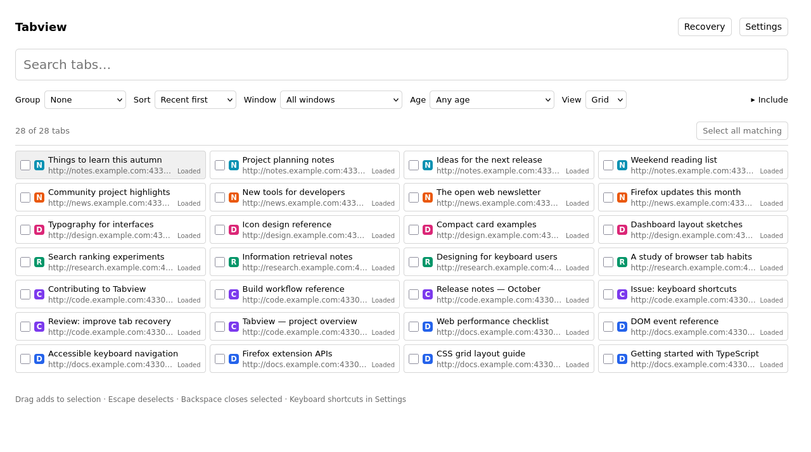
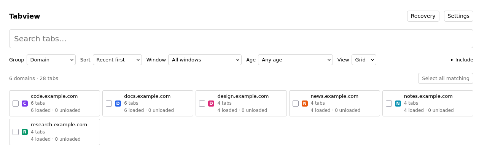
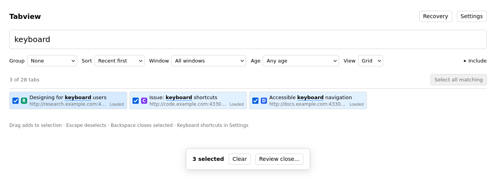

## tab management for the tab hoarder

I slopped this together because I hoard too many tabs in Zen (500+) and need a good way to manage and bulk close them.

## features

- fuzzy search by title or URL
- group by domain, date, or topic
- filter by window or time since last used
- drag to select and bulk close tabs
- reopen closed tabs from local recovery
- customizable keyboard shortcuts







## try it

- Grab a ZIP from Releases or Actions and unzip it (twice for Actions).
- In Firefox 140+ or Zen: `about:debugging` → **This Firefox → Load Temporary Add-on** → `manifest.json`.
- Open it from the toolbar or press **Ctrl+Alt+Y**.

It's unsigned for now, so you'll need to load it again after restarting the browser.

## build it yourself

With Node 22.12+ or 24+:

```sh
npm ci
npm run build
```

Then load `dist/manifest.json` the same way.
