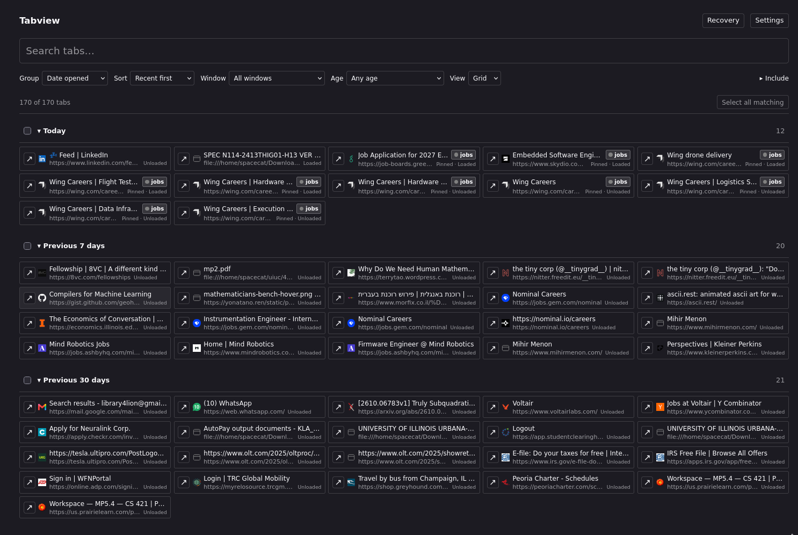
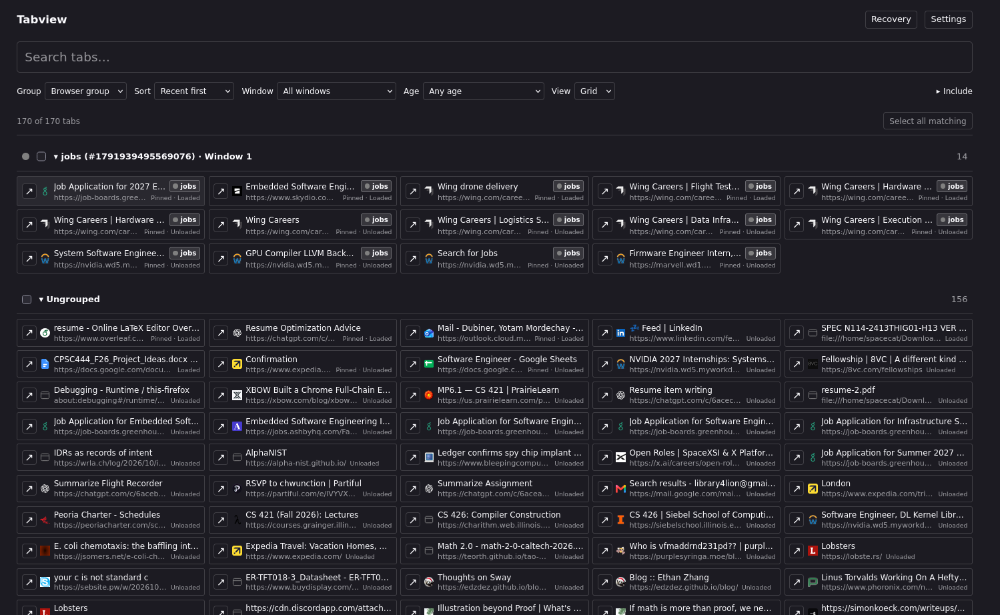

## tab management for the tab hoarder

I slopped this together because I hoard too many tabs in Zen (500+) and need a good way to manage and bulk close them.

works well with the [Advanced-Tab-Groups](https://github.com/Vertex-Mods/Advanced-Tab-Groups) [sine](https://github.com/CosmoCreeper/Sine) plugin 

## features

- fuzzy search by title or URL
- group by domain, date, topic, or browser tab group
- press **G** with tabs selected (or click **Group selected…**) to add them to an existing browser group or create a named group; tabs can move across windows, and selected pinned tabs are unpinned
- filter by window or time since last used
- click a tab row to select it, Shift-click to select a range, or drag to select and bulk close tabs
- use the ↗ button beside each tab to switch to it
- reopen closed tabs from local recovery
- customizable keyboard shortcuts








## try it

- Grab a ZIP from Releases or Actions and unzip it (twice for Actions).
- In Firefox 140+ or Zen: `about:debugging` → **This Firefox → Load Temporary Add-on** → `manifest.json`.
- Open it from the toolbar or press **Ctrl+Alt+Y**.

It's unsigned for now, so you'll need to load it again after restarting the browser.

## build it yourself

With Node 22.12+ or 24+:

```sh
npm ci
npm run build
```

Then load `dist/manifest.json` the same way.
